# Guía de Contribución y Gobernanza del Repositorio (`CONTRIBUTING.md`)

Bienvenido a **Crypto Hardware Command Inspector (`chci`)**. Para garantizar la máxima estabilidad, integridad criptográfica y seguridad del proyecto, este repositorio implementa **políticas estrictas de protección de ramas y control de cambios**.

---

## 1. Política de Protección de la Rama `master`

La rama `master` representa el código auditado y listo para producción del proyecto. Está protegida con las siguientes reglas inviolables:

1. **Prohibido el Push Directo**: Ningún desarrollador ni administrador puede hacer `git push origin master` de forma directa. Todo cambio debe originarse en una rama separada y consolidarse mediante una **Pull Request (PR)**.
2. **Prohibido el Force Push (`--force`)**: El historial de `master` es inmutable. Los force-pushes están deshabilitados a nivel de GitHub.
3. **Prohibido el Borrado de Rama**: `master` no puede ser eliminada.
4. **Verificación de Integridad Obligatoria (CI Gates)**:
   - Toda PR hacia `master` debe superar obligatoriamente el pipeline de CI:
     - **Linting** (ESLint 9 sin advertencias).
     - **TypeScript Typecheck** (`tsc --noEmit` en todos los workspaces).
     - **Unit & Integration Tests** (Vitest con cobertura `≥80%` global y `≥90%` en `parser-core`).
     - **Build** (Compilación y bundling de producción con Vite).
     - **Playwright E2E** (Verificación end-to-end de UI y flujos de usuario).
5. **Resolución de Conversaciones**: Todos los hilos de discusión y revisiones en la PR deben estar marcados como resueltos antes de autorizar el merge.
6. **Rama Actualizada**: La rama de la PR debe estar sincronizada con `master` antes del merge (`strict branch protection`).
7. **Revisión por Pares**: Las contribuciones de usuarios externos requieren al menos una aprobación (`APPROVED`) de un mantenedor del proyecto.

---

## 2. Flujo de Trabajo para Nuevas Funcionalidades y Correcciones

Para contribuir al proyecto, sigue este flujo paso a paso:

```mermaid
flowchart LR
    A["1. master"] -->|"git checkout -b feature/mi-cambio"| B["2. Rama de Trabajo"]
    B -->|"pnpm verify && pnpm e2e"| C["3. Tests Locales en Verde"]
    C -->|"git push origin feature/mi-cambio"| D["4. Abrir Pull Request"]
    D -->|"GitHub Actions CI"| E["5. Quality Gates en Verde"]
    E -->|"Revisión y Aprobación"| F["6. Merge en master"]
```



### Paso 1: Actualizar la base local y crear la rama
```bash
git checkout master
git pull origin master
git checkout -b feature/nombre-de-la-funcionalidad
# o para correcciones:
git checkout -b fix/nombre-del-bug
```

### Paso 2: Realizar cambios siguiendo los estándares ECC
- **TypeScript Estricto**: `strict: true`, `noUncheckedIndexedAccess: true`, sin tipos `any`.
- **Seguridad por Defecto**:
  - Toda entrada de datos externos debe validarse con **Zod**.
  - Los campos confidenciales (PIN blocks, claves, criptogramas) deben marcarse como `sensitive: true` para enmascarado automático.
  - La directiva CSP de Tauri debe mantenerse en `connect-src 'none'` (100% offline).
- **TSDoc / JSDoc**: Todas las funciones, interfaces y módulos deben incluir documentación TSDoc explicativa.

### Paso 3: Validar la suite de pruebas localmente
Antes de realizar el commit, asegúrate de que todos los Quality Gates pasen en verde:
```bash
pnpm verify      # Ejecuta typecheck, lint, test:coverage y build
pnpm e2e         # Ejecuta las pruebas E2E con Playwright
```

### Paso 4: Realizar commit con formato Conventional Commits
Utiliza mensajes semánticos:
```bash
git add -A
git commit -m "feat(modulo): descripcion concisa del cambio"
# Prefijos permitidos: feat:, fix:, docs:, test:, refactor:, chore:, perf:
```

### Paso 5: Subir la rama y abrir la Pull Request
```bash
git push -u origin feature/nombre-de-la-funcionalidad
```
Abre la PR en GitHub hacia `master` detallando:
- Propósito del cambio.
- Módulos afectados.
- Pruebas realizadas.

---

## 3. Seguridad y Protección de Secretos

- **Secret Scanning & Push Protection**: El repositorio tiene habilitado el bloqueo automático de secretos de GitHub. Cualquier intento de hacer push de un archivo que contenga claves privadas, certificados no autorizados o tokens de acceso será **rechazado de forma automática**.
- **Dependabot**: Monitoreo continuo de dependencias con alertas de vulnerabilidad automatizadas.
- **Sin Archivos Confidenciales**: Nunca incluyas archivos `.env`, `.chci_history`, documentación bajo NDA de fabricantes ni binarios `.tar` propietarios.

---

*Crypto Hardware Command Inspector — Offline Security Diagnostic Tool*
