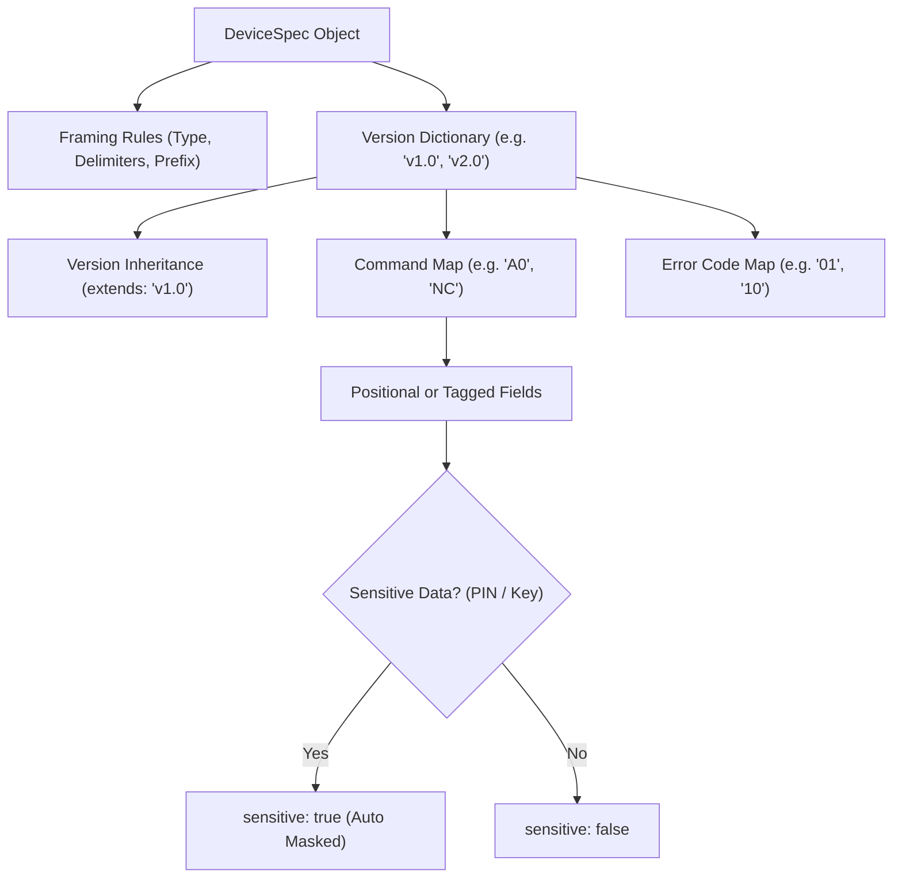

# Developer Guide: Adding a New Device Specification

This guide walks through the step-by-step process of adding support for a new Hardware Security Module (**HSM**) or Key Management System (**KMS**) to **Crypto Hardware Command Inspector (`chci`)**.

---

## 1. Overview of the Specification Model

Every device in `chci` is modeled declaratively in `packages/device-specs/src/devices/`. Hardware specifications are strictly typed and validated using Zod schemas (`DeviceSpecSchema` from `@chci/parser-core`).



---

## 2. Step-by-Step Implementation

### Step 1: Create the Device Module

Create a new file in `packages/device-specs/src/devices/` (for example, `packages/device-specs/src/devices/my-hsm.ts`):

```typescript
import type { DeviceSpec } from '@chci/parser-core';

export const myHsmSpec: DeviceSpec = {
  id: 'my-vendor-hsm',
  name: 'My Vendor Cryptographic HSM',
  vendor: 'My Vendor Inc.',
  category: 'HSM_FINANCIAL',
  status: 'supported',
  description: {
    es: 'Módulo de seguridad de hardware para pagos y transacciones bancarias.',
    en: 'High-performance hardware security module for banking payments.'
  },
  defaultVersion: '1.0',
  documentationUrl: 'https://docs.myvendor.com/hsm/manual',
  framing: {
    type: 'header-positional', // or 'delimited-positional' or 'tag-value'
    headerLength: 4
  },
  versions: {
    '1.0': {
      version: '1.0',
      releaseDate: '2025-01-15',
      commands: {
        'NC': {
          code: 'NC',
          name: {
            es: 'Diagnóstico y Estado de Red',
            en: 'Network Diagnostics and Health'
          },
          direction: 'request',
          pairedCode: 'ND',
          fields: []
        },
        'ND': {
          code: 'ND',
          name: {
            es: 'Respuesta de Diagnóstico de Red',
            en: 'Network Diagnostics Response'
          },
          direction: 'response',
          pairedCode: 'NC',
          fields: [
            {
              id: 'errorCode',
              name: { es: 'Código de Error', en: 'Error Code' },
              type: 'ascii',
              format: '2AN',
              length: 2,
              required: true
            }
          ]
        }
      },
      errorCodes: {
        '00': {
          code: '00',
          name: { es: 'Operación Exitosa', en: 'Success' },
          description: {
            es: 'El comando fue ejecutado sin errores.',
            en: 'Command executed successfully.'
          }
        },
        '01': {
          code: '01',
          name: { es: 'Error de Formato', en: 'Format Error' },
          description: {
            es: 'La trama no cumple con la longitud o caracteres válidos.',
            en: 'The request frame violates field length or character encoding.'
          },
          possibleCauses: [
            {
              es: 'Longitud de cabecera no coincide con la esperada.',
              en: 'Header length does not match expected transport configuration.'
            }
          ]
        }
      }
    }
  }
};
```

---

### Step 2: Version Inheritance (`extends`)

When modeling a firmware upgrade (e.g., version `2.0` that adds new commands while retaining backwards compatibility):

```typescript
versions: {
  '1.0': { /* base version */ },
  '2.0': {
    version: '2.0',
    releaseDate: '2026-03-01',
    extends: '1.0', // Inherits all commands and error codes from 1.0
    commands: {
      'CW': {
        code: 'CW',
        name: { es: 'Importar Clave AES', en: 'Import AES Key' },
        direction: 'request',
        pairedCode: 'CX',
        fields: [
          {
            id: 'keyCryptogram',
            name: { es: 'Criptograma de Clave', en: 'Key Cryptogram' },
            type: 'hex',
            format: '32H',
            length: 32,
            required: true,
            sensitive: true // Auto-masked as •••••••• in the UI
          }
        ]
      }
    },
    errorCodes: {
      '25': {
        code: '25',
        name: { es: 'Paridad Incorrecta', en: 'Invalid Parity' },
        description: {
          es: 'La paridad de la clave DES/AES es inválida.',
          en: 'Injected key fails odd/even parity verification.'
        }
      }
    }
  }
}
```

---

### Step 3: Register in the Device Catalog

1. Open `packages/device-specs/src/catalog.ts` and add `myHsmSpec` to `DEVICE_CATALOG`.
2. Open `packages/device-specs/src/index.ts` and export `myHsmSpec`.

---

### Step 4: Write Unit Tests & Verify

Add a test in `packages/device-specs/src/__tests__/specs-validation.test.ts` to verify Zod schema validation:

```typescript
it('validates myHsmSpec against DeviceSpecSchema', () => {
  const result = DeviceSpecSchema.safeParse(myHsmSpec);
  expect(result.success).toBe(true);
});
```

Run verification:
```bash
pnpm verify
```
