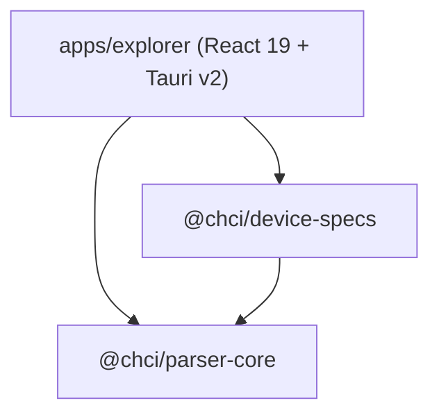
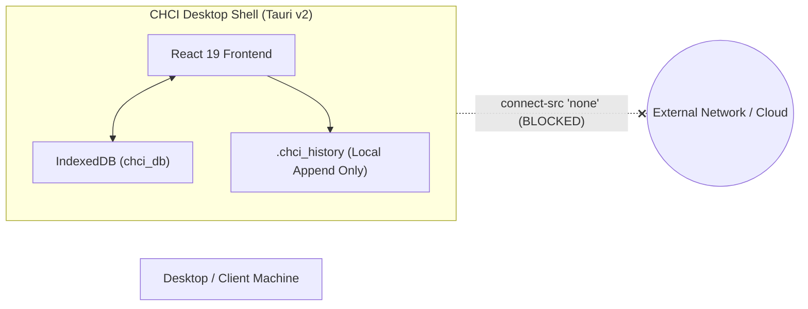

# System Architecture & Technical Overview

This document describes the high-level architecture, design decisions, and security model of **Crypto Hardware Command Inspector (`chci`)**.

---

## 1. Monorepo Organization

The project is structured as a `pnpm` monorepo enforcing strict boundary separation between the parser algorithms, declarative hardware specifications, and the user interface.

```text
CryptoCommandExplorer/
├── packages/
│   ├── parser-core/       # 100% UI-independent parsing engine & normalizer
│   └── device-specs/      # Declarative hardware specifications (Atalla, Thales, Futurex)
├── apps/
│   └── explorer/          # React 19 + Vite 7 + Tauri v2 Desktop & Web application
├── docs/                  # Architecture, PRD, user guides, screenshots
└── e2e/                   # Playwright end-to-end integration test suite
```

### Dependency Graph



- `@chci/parser-core` has **zero runtime UI dependencies** and can be run in any Node.js, browser, or edge runtime.
- `@chci/device-specs` imports framing and schema types from `@chci/parser-core` and exports verified specifications.
- `apps/explorer` consumes both packages, providing interactive CodeMirror 6 editing, 8-block accordion inspection, and IndexedDB persistence.

---

## 2. Framing Engines (`@chci/parser-core`)

Hardware Security Modules (HSMs) communicate using distinct low-level framing protocols. `chci` implements three specialized engines:

### 2.1. Delimited Positional (`parseDelimitedPositional`)
- **Target Hardware**: Utimaco / Atalla AT1000 (v8.50, v8.60).
- **Framing Structure**: `<CMD#field1#field2#...#>`
- **Characteristics**:
  - Enclosed in start delimiter `<` and end delimiter `>`.
  - Fields separated by `#`.
  - First token represents the command code (e.g. `00`, `31`).
  - Positional parameter mapping based on active command schema.
  - Automatic error code identification on response frames (e.g. `<31#Y#01#>`).

### 2.2. Header Positional (`parseHeaderPositional`)
- **Target Hardware**: Thales payShield 10K / 9000 (v1.9, v2.3).
- **Framing Structure**: `[HEADER][CMD][PARAMS...]`
- **Characteristics**:
  - Optional user-configured transport header (4 or 12 hex characters, e.g. `0000`).
  - 2-character command code (e.g. `NC`, `A0`, `CW`).
  - Positional parameters with dynamic key-length resolution (`resolveThalesKeyLength`):
    - Thales Key Blocks (`'S'` + 4-digit length).
    - TR-31 Key Blocks (`'R'` + 4-digit length).
    - Prefixed variants: `'Z'` (single-length), `'U'`/`'X'` (double-length), `'T'`/`'Y'` (triple-length).

### 2.3. Tag-Value (`parseTagValue`)
- **Target Hardware**: Futurex Excrypt EXP9000 / Securus (v7.6.1).
- **Framing Structure**: `[TAG1val1;TAG2val2;...]`
- **Characteristics**:
  - Enclosed in brackets `[` and `]`.
  - 2-character uppercase mnemonic tags (e.g., `AO` = command code, `AG` = echo/context token, `AM` = error code).
  - Delimited by semicolons `;`.
  - Flexible tag ordering with mandatory tag validation and duplicate tag diagnostics.

---

## 3. Diagnostic Engine & Cross Correlation

The engine produces an immutable `ParseResult` for every input:

```typescript
export interface ParseResult {
  readonly deviceId: string;
  readonly version: string;
  readonly raw: string;
  readonly normalized: NormalizedInput;
  readonly framingType: FramingType;
  readonly detectedDirection: CommandDirection | 'unknown';
  readonly expectedDirection?: CommandDirection;
  readonly commandCode: string | null;
  readonly matchedCommand: CommandSpec | null;
  readonly pairedCommand: CommandSpec | null;
  readonly isErrorResponse: boolean;
  readonly errorCode: string | null;
  readonly errorSpec: ErrorCodeDefinition | null;
  readonly segments: readonly FrameSegment[];
  readonly fields: readonly ParsedField[];
  readonly diagnostics: readonly ParseDiagnostic[];
  readonly valid: boolean;
  readonly echoToken?: string | null;
}
```

### Request ↔ Response Correlation (`correlateCommands`)
When two commands are linked, `correlateCommands` evaluates:
1. **Command Pair Match**: Verifies that the request's `pairedCode` matches the response's `commandCode` (e.g. `A0` -> `A1`, `00` -> `01`).
2. **Transport Header Match**: Verifies that transport headers match identically.
3. **Echo Token Consistency**: Verifies that transaction context tokens (Futurex `AG`, Atalla `^CTX`) are mirrored correctly.
4. **Error Evaluation**: Flags if the response is an error frame and resolves the vendor description.

---

## 4. Security Architecture & Offline Isolation



### 4.1. Network Isolation
- **Content Security Policy**: `default-src 'self'; script-src 'self'; style-src 'self' 'unsafe-inline'; img-src 'self' data:; font-src 'self' data:; connect-src 'none'; frame-src 'none'; object-src 'none';`.
- **Tauri Permissions**: Capabilities file (`apps/explorer/src-tauri/capabilities/default.json`) restricts permissions strictly to `dialog:default` and `fs:default`. Network plugins (`tauri-plugin-http`) are entirely omitted.

### 4.2. Sensitive Field Protection
- All fields with `sensitive: true` (cryptographic keys, PIN blocks) render as `••••••••` by default.
- Masking state is held in transient React component state and immediately resets whenever the user switches commands or tabs.
- Values are never saved in cleartext to local storage or unencrypted logs.

### 4.3. Persistence & Schemas
- Local persistence in IndexedDB (`chci_db` v1).
- Session exports validated strictly via Zod schema (`chci-session-v1.json`). Payloads larger than 10 MB are rejected at the boundary.
- Append-only `.chci_history` file format for audit trail logging.
