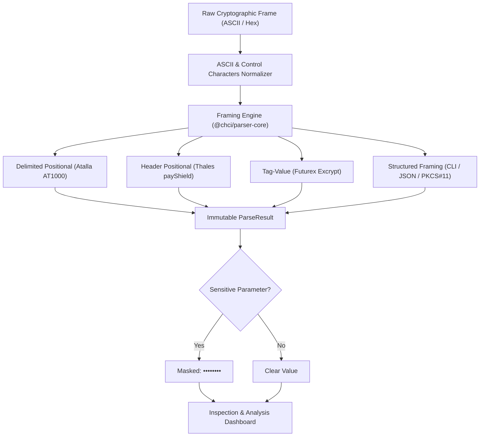
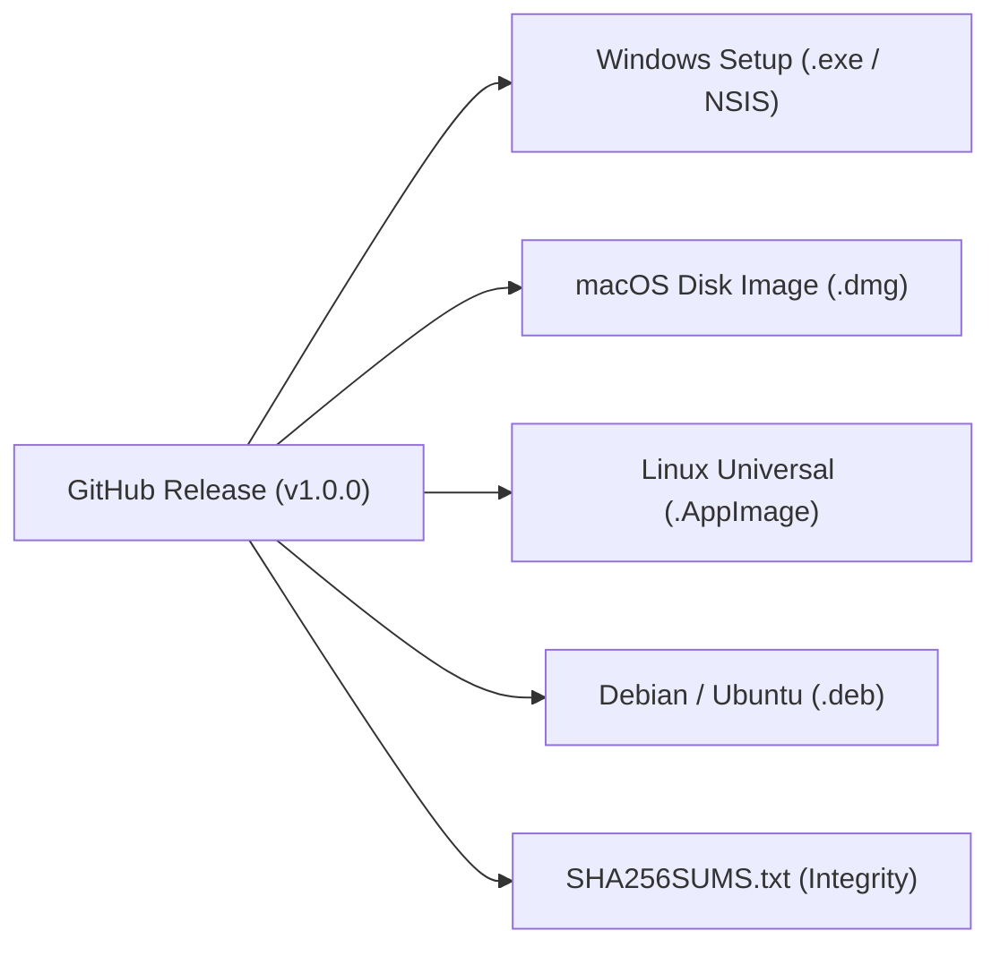
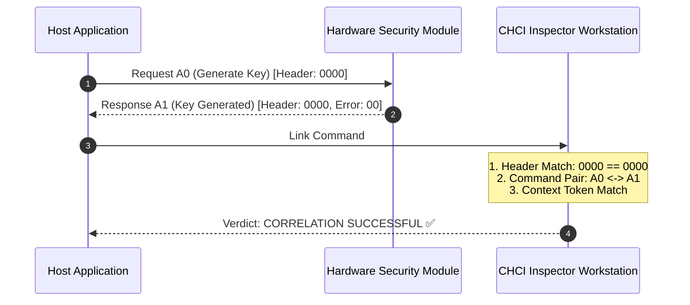

# Official User Guide — Crypto Hardware Command Inspector (`chci`)

Welcome to the **Official and Comprehensive User Guide** for **Crypto Hardware Command Inspector (`chci`)** (Release **v1.0.0**).

`chci` is an air-gapped cryptographic desktop workstation designed for security engineers, payment gateway developers, PCI-DSS auditors, and banking infrastructure operators who interface daily with Hardware Security Modules (**HSM**) and Key Management Systems (**KMS**).

---

## 1. Security Architecture & Zero-Network Philosophy

Banking and payment HSM software processes highly sensitive cryptographic material:
- PIN blocks (ISO 9564 Formats 0, 1, 3, 4).
- Key cryptograms encrypted under Local Master Keys (LMK / MFK).
- Double and triple-length 3DES/AES variants and ANSI X9.143 / TR-31 Key Blocks.
- Asymmetric private key components (RSA, ECC Curve25519, NIST P-256).

Accordingly, `chci` enforces an uncompromising **Security-First** policy:

1. **Air-Gapped Isolation**:
   - In the native desktop application (**Tauri v2**), the Content Security Policy (CSP) enforces `connect-src 'none'`. There is zero internet connectivity, zero remote telemetry, and zero unauthenticated network calls.
   - The framing engine (`@chci/parser-core`), hardware specifications (`@chci/device-specs`), persistence layer, and technical documentation reside 100% on the local system.
2. **Default Sensitive Masking**:
   - Every parameter designated with `sensitive: true` (key cryptograms, clear components, PIN blocks) is automatically masked with the pattern `••••••••`.
   - Operators can selectively reveal or conceal values using individual eye icons or the global toggle switch. When switching between commands, all fields revert immediately to their protected state.
3. **Local & Validated Storage**:
   - Sessions are stored in the local IndexedDB or exported as strictly validated JSON files (`chci-session-v1.json` via **Zod**) and plain-text audit logs (`.chci_history`).

---

## 2. Multiplatform Installation & Deployment

`chci` is officially distributed across all three major desktop operating systems:

### 2.1 On Windows (Modular NSIS Setup)
The installer `Crypto-Hardware-Command-Inspector_x64-setup.exe` provides an interactive setup wizard:
- **Custom Destination Folder**: Operators can click *"Browse..."* and pick any drive or folder path (e.g. `D:\Tools\CHCI`).
- **Modular Component Selection**:
  - ☑️ **CHCI Core Application**: Main application and hardware specifications viewer (~45 MB, Required).
  - 🔲/☑️ **Utimaco Atalla AT1000 v8.56 Simulator**: Offline Docker `.tar` package (~848 MB, Optional checkbox). When selected, it installs neatly into `$INSTDIR\simulators\atalla-at1000\`. **It never litters the Desktop**.
- **Optional Shortcuts (Opt-In Only)**:
  - Checkbox: *Create Desktop Shortcut* (unchecked by default).
  - Checkbox: *Create Start Menu Shortcut* (unchecked by default).
  - Only shortcuts explicitly enabled by the user are generated.

### 2.2 On macOS (Disk Image `.dmg`)
- Drag `Crypto Hardware Command Inspector.app` from the `.dmg` into `/Applications` or any user directory.
- No desktop shortcuts are created automatically. Users can pin the application to the Dock at their own discretion.

### 2.3 On Linux (Universal AppImage and DEB)
- **Universal AppImage**: Portable binary executable out-of-the-box on any Linux distribution (Ubuntu, Debian, Fedora, Arch, SUSE). Place it anywhere (e.g. `~/bin/` or `/opt/`).
- **Debian Package (`.deb`)**: Standard installation via `sudo dpkg -i chci.deb` with clean desktop environment launcher integration.

---

## 3. Supported Hardware Catalog

The left sidebar categorizes all 10 supported cryptographic appliances into 4 architectural families:

1. **Financial / Payment HSM**:
   - **Utimaco Atalla AT1000** (Firmware v8.60 / v8.56).
   - **Thales payShield 10K** (Firmware v2.3 / v1.9).
   - **Futurex Excrypt** (Firmware v7.6.1).
2. **General-Purpose HSM**:
   - **Thales Luna 7** (PKCS#11 Callable C APIs and Lunash CLI).
   - **IBM CCA 4769** (Callable C Verbs and Management CLI).
   - **Yubico YubiHSM 2** (YubiHSM-Shell CLI and PKCS#11).
3. **Key Management Systems (KMS)**:
   - **AWS KMS** (REST JSON and AWS CLI).
   - **HashiCorp Vault Transit** (REST API v1 and Vault CLI).
4. **HSM as a Service / Cloud HSM**:
   - **Marvell LiquidSecurity HSM** (Liquid CLI v3.4.0 and PKCS#11).
   - **Azure Dedicated Payment HSM** (TCP RAW and Management CLI).

### Catalog Overview in Light Theme

### Catalog Overview in Dark Theme

---

## 4. Command Editor & Interface Selector

The central workspace provides a modern cryptographic editing environment powered by **CodeMirror 6**:

- **Real-Time Syntax Highlighting**: Delimiters, tags, positional fields, and hex strings are highlighted with category-specific colors.
- **Standard vs. Proprietary Interface Selector**:
  - For hardware supporting multiple interfaces (such as Thales Luna 7 or Marvell LiquidSecurity), each command displays a badge and selector:
    - `[STD]` Industry Standard Interface (e.g. PKCS#11, REST JSON, KMIP).
    - `[PROP]` Proprietary Appliance Interface (e.g. Native CLI, RAW ASCII).

---

## 5. Cryptographic Analysis Dashboard & Frame View

The right analysis dashboard inspects and desugars incoming or outgoing payloads in real time:

1. **Segmented Frame View**: Visual block representation showing each field with its official specification name and category color.
2. **Multiline Parameter Table**: Fixed layout (`table-fixed`, `break-all`) preventing horizontal scrolling or overflow on 74-character or 128-character cryptographic keys.
3. **Dual-Mode AKB vs. Variant Detection**:
   - Automatic detection of key mode:
     - 🌸 **AKB (Atalla Key Block)**: Key formatted as a 74-character block. Highlighted with a distinctive pink badge.
     - 🟪 **Variant**: Key encrypted under traditional variant masking (32 or 48 characters). Highlighted with a purple badge.
4. **Expandable Parameter Info `(i)`**: Clicking the information button reveals the official technical manual explanation, valid formats, and usage examples.
5. **Manufacturer Safety Notes**: Styled cards displaying `CAUTION`, `IMPORTANT`, `TIP`, and `NOTE` alerts.

---

## 6. Utimaco Atalla AT1000 Command Inspection

The Atalla **Delimited Positional** framing utilizes `<` and `>` with `#` delimiters:
- General format: `<CmdCode#SubCode#Param1#Param2#...#>`

### Example: Error Response Inspection
Inspecting an error response `<31#Y#01#>`:
- The analyzer flags error code `01` (*"Invalid command format"*).
- Lists documented technical causes (field length mismatch, missing `#` delimiter, non-hex character).

---

## 7. Thales payShield 10K Command Inspection

The Thales **Header-Positional** framing uses a configurable transport header followed by a 2-character command code:
- General format: `[Header 4B][Code 2B][Data...]`
- Automatic key type detection based on official prefixes:
  - `U`: Double-length 3DES key (32 hex).
  - `T`: Triple-length 3DES key (48 hex).
  - `S`: Proprietary Thales Key Block.
  - `R`: ANSI X9.143 / TR-31 Key Block.

### Key Cryptogram Masking
When typing a generation command such as `A00000U0123456789ABCDEF0123456789ABCDEF`:
- The LMK-encrypted key field is masked by default as `••••••••`.
- The operator can audit the plain value using the eye toggle.

---

## 8. Futurex Excrypt Command Inspection

**Futurex Excrypt** HSM appliances utilize **Tag-Value** framing:
- Encapsulated within `[` and `]`.
- Each parameter consists of a 2-character mnemonic tag (`AO`, `AG`, `BB`, etc.) followed by the value and terminated with a semicolon `;`.

### Example: Echo Command
Inspecting `[AOECHO;AGhello;]`:
- `AO` is desugared as command code `ECHO`.
- `AG` is desugared as context user data.

---

## 9. Request ↔ Response Automatic Correlation

Auditing live banking operations requires validating that received HSM responses correspond to the outbound requests.

### Procedure:
1. Create Command #1 as `Request` (`A0...`).
2. Create Command #2 as `Response` (`A100...`).
3. Under Command #2, select *"Linked to command #1"*.
4. The **"Request ↔ Response Link"** section confirms header parity, command code pair match, and context consistency.

---

## 10. Integrated Offline Technical Documentation Viewer

`chci` bundles official manufacturer specifications accessible without an internet connection:
- **Header Button**: Instant access to technical documentation.
- **Category Tabs**: Filter by *"All"*, *"Chapters"*, *"Commands"*, or *"Appendices"*.
- **Live Search**: Instant text filtering by command code (e.g. `BF`, `A0`, `ECHO`) or description.
- **Rich Markdown**: Syntax highlighting, AKB/Variant tinted tables, clickable links, and manufacturer notice cards.

---

## 11. Utimaco Atalla AT1000 Official Simulator

For offline development without physical hardware, `chci` includes direct control of the official Utimaco Atalla AT1000 Docker simulator:

- **Live Appliance Telemetry**: SMOS SDK 5.6.4.1 firmware status, serial number `SIM123`, and Master File Keys (`MFK1: B196`, `AMK1: B9BC`).
- **Animated Startup Progress**: Tracks the 4 internal Utimaco initialization milestones (~30s): Docker Container, SMOS Kernel, Flash Memory, and TCP Port 7000 Listener.
- **Continuous Health Heartbeat**: Polls every 4.5s and notifies if the container unexpectedly drops.
- **Quick Self-Test Diagnostics**: Direct buttons to execute live tests:
  - `<00#TEST#1234#>` (Echo).
  - `<9A#ID#>` (HSM Info / Firmware).
  - `<9A#KEY#>` (MFK Status).
- **Guaranteed Automatic Stop**: When closing the application (`X`, `Alt+F4`, Quit, or process termination), the simulator is automatically and synchronously stopped and cleaned up (`docker stop -t 2 && docker rm -f`).

---

## 12. Direct Hardware Connections & Live Execution

Validate commands directly against physical appliances or banking HSM proxies:
- **Protocol Configuration**: Supports direct RAW TCP, encrypted TLS, and mutual-authenticated mTLS.
- **PEM Certificates & Keys**: Input fields for Server CA Certificate, Client Certificate, and Client Private Key in PEM format.
- **Live Execution with Latency Diagnostics**: Run commands directly using the *Play* button with millisecond execution timing and network diagnostics.

---

## 13. Session Library, Audit History & JSON Export

- **IndexedDB Session Library**: Save, load, duplicate, and manage multi-tab audit sessions with commands and interface settings preserved.
- **Zod-Validated JSON Import/Export**: Open format `chci-session-v1.json` with rigorous boundary validation for sharing audit workspaces.
- **Flat History Log `.chci_history`**: Automatic audit logging in plain text (`.bash_history` format) with ISO timestamp, device ID, version, direction, and raw payload.

### Session Library

### Audit History Log (.chci_history)

---

## 14. Multilingual Support (English / Spanish / Galician)

All user interfaces, command catalogs, parameter desugarers, and error manuals offer full localization:
- Toggle between **English (`EN`)**, **Español (`ES`)**, and **Galego (`GL`)** via the header language selector without reloading or losing state.

---

## Quick Reference & Shortcuts

| Operation | Action / Shortcut |
|---|---|
| **New Command** | `+` button in header or command list. |
| **Hardware Docs** | Book icon button in header. |
| **Atalla Simulator** | Server icon button in header or sidebar. |
| **Direct Connections** | Link icon button on the device card. |
| **Reveal Key / PIN** | Eye icon on parameter row in analysis panel. |
| **Parameter Details** | `(i)` button on parameter row in analysis panel. |
| **Export Session** | Sessions -> *Export JSON*. |
| **Download Audit Log** | History -> *Download .chci_history*. |
| **Close Dialogs** | `Escape` key or click outside modal. |
