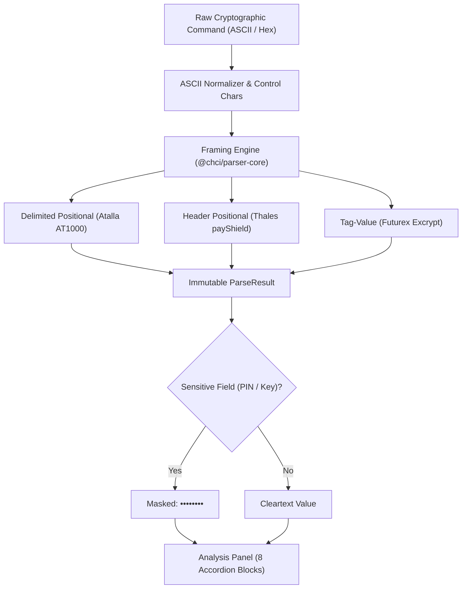
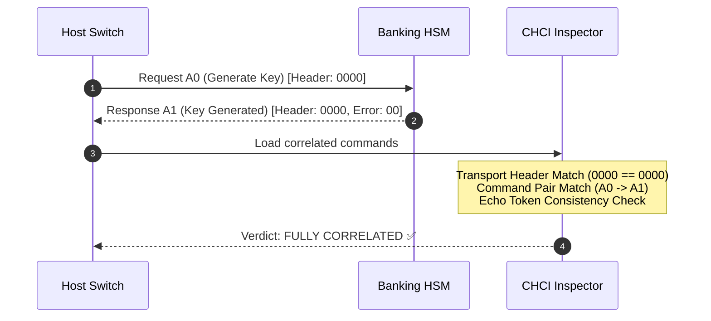

# User Guide — Crypto Hardware Command Inspector (`chci`)

Welcome to the **Official User Guide** for **Crypto Hardware Command Inspector (`chci`)**.

`chci` is an air-gapped cryptographic command inspection, debugging, and audit tool designed for security engineers, payment switch architects, and banking infrastructure operators interacting with Hardware Security Modules (**HSMs**) and Key Management Systems (**KMSs**).

---

## 1. Security Architecture & Zero-Network Philosophy

Commands and protocol frames exchanged with banking HSMs routinely carry highly confidential cryptographic material: PIN blocks (ISO 9564), cryptograms encrypted under LMK (Local Master Keys), 2TDEA/3TDEA variants, or ANSI X9.143 / TR-31 key blocks.

For this reason, `chci` is built with a strict **Security-First** posture:

1. **100% Offline / Air-Gapped Operation**:
   - In the desktop application (**Tauri v2**), the Content Security Policy enforces `connect-src 'none'`. There is zero access to external networks, HTTP endpoints, WebSockets, or telemetry.
   - All parsing engines (`@chci/parser-core`), hardware specifications (`@chci/device-specs`), and persistence reside strictly in local memory and client IndexedDB storage.
2. **Web Sandbox Protection**:
   - When running as a public demonstration web app (`VITE_TARGET=web`), a persistent security banner warns users never to input production cryptographic keys or PIN blocks and points operators to the official offline desktop binaries.
3. **Sensitive Field Masking by Default**:
   - All fields defined with `sensitive: true` (keys, cryptograms, PIN blocks) are masked by default as `••••••••`. Operators can reveal individual fields or toggle global visibility. Switching active commands immediately resets all fields back to masked state.



---

## 2. Hardware Catalog & Device Navigation

The catalog sidebar enables exploration of cryptographic hardware across four families:
- **Financial HSM**: Utimaco / Atalla AT1000, Thales payShield 10K, Futurex Excrypt.
- **General Purpose HSM**: Utimaco CryptoServer, Thales Luna 7, Securosys Primus.
- **KMS**: HashiCorp Vault Transit, AWS KMS, Google Cloud KMS, Fortanix DSM.
- **HSM as a Service**: AWS CloudHSM, Azure Dedicated HSM, Marvell LiquidSecurity.

Operators can filter by family, search in real-time, and launch independent workspace tabs for each supported device.

### Light Theme


### Dark Theme


---

## 3. Workflow 1: Futurex Excrypt Command Inspection

**Futurex Excrypt** security appliances (EXP9000, Securus) use a **Tag-Value** framing syntax:
- Frames are enclosed in brackets `[` and `]`.
- Every field begins with a 2-character tag identifier (`AO` for command code, `AG` for echo/context data, etc.), followed by value payload and terminated by a semicolon `;`.

### Steps:
1. Open the **Futurex Excrypt** tab from the catalog sidebar.
2. Enter the test command into the CodeMirror editor:
   ```text
   [AOECHO;AGhola;]
   ```
3. CodeMirror renders visual badges for delimiters and tags.
4. The **Detailed Analysis Panel** displays:
   - **General Information**: Detected command `ECHO`, Direction `Request`.
   - **Parameter Breakdown**: Tag-by-tag table. Hovering over any parameter highlights the corresponding character span in the editor.


---

## 4. Workflow 2: Thales payShield 10K & Sensitive Field Masking

**Thales payShield 10K** (and 9000) employs a **Header-Positional** framing structure:
- Optional fixed-length transport headers (e.g. 4 or 12 hex characters like `0000`).
- 2-character command code (`A0` for key generation, `NC` for diagnostics, `CW` for import).
- Dynamic-length key fields identified by format prefix (`U` for double-length 3DES, `T` for triple-length, `S` for Thales Key Block, `R` for TR-31).

### Steps:
1. Open the **Thales payShield 10K** tab.
2. Set the header length to `4`.
3. Input the key generation command:
   ```text
   A00000U0123456789ABCDEF0123456789ABCDEF
   ```
4. Note that the LMK-encrypted key field is masked as `••••••••`.
5. Click the eye icon in the parameter table or the *"Show sensitive"* switch to reveal the cleartext value.


---

## 5. Workflow 3: Request ↔ Response Correlation

In high-throughput payment transaction pipelines, correlating responses to outgoing requests is essential for diagnostic validation.



### Steps:
1. Click **"New command"** (`+`) in the active tab.
2. Configure Command #1 as `Request` (`A0...`) and Command #2 as `Response` (`A100`).
3. Set Command #2's link selector to *"Linked to command #1"*.
4. Expand the **"Request ↔ Response Correlation"** block in the analysis panel to view automated cross-checks (Header Match, Pair Match, Echo Token).


---

## 6. Workflow 4: Utimaco Atalla AT1000 Error Diagnostics

**Utimaco / Atalla AT1000** commands are structured using hash-delimited tokens enclosed in `<` and `>`:
- Syntax: `<CMD#field1#field2#...#>`
- If an operation fails, the HSM returns a 2-character error code.

### Steps:
1. Open the **Utimaco Atalla AT1000** tab.
2. Input the error response frame:
   ```text
   <31#Y#01#>
   ```
3. The analysis panel detects the error state and displays:
   - **Response / Error Code**: Code `01`, official name *"Invalid command format"*, and detailed root-cause documentation.
   - **Diagnostics**: Graded alerts (`error`, `warning`, `info`).


---

## 7. Workflow 5: Session Management & JSON Export/Import

`chci` preserves full workspace configurations across tabs and commands in IndexedDB:
- Standard schema: `chci-session-v1.json`.
- Strict validation with **Zod** upon import (10 MB payload limit, strict schema conformance).
- Session actions: **Save Session**, **Load Session**, **Duplicate**, **Delete**, and **Export/Import JSON**.


---

## 8. Workflow 6: Flat Audit History (`.chci_history`)

Every parsed command is logged to an append-only `.chci_history` file:
```text
# Crypto Hardware Command Inspector History (.chci_history)
# Format: ISO_TIMESTAMP | DEVICE_ID | VERSION | DIRECTION | RAW_COMMAND
2026-10-20T20:10:00.000Z | futurex-excrypt | 7.6.1 | request | [AOECHO;AGhola;]
2026-10-20T20:11:00.000Z | thales-payshield-10k | 2.3 | request | A00000U0123456789ABCDEF0123456789ABCDEF
2026-10-20T20:11:30.000Z | thales-payshield-10k | 2.3 | response | A100
2026-10-20T20:12:00.000Z | utimaco-atalla-at1000 | 8.60 | response | <31#Y#01#>
```

Access the **History Modal** (`History` button in header) to:
- Search and filter command entries in real-time.
- Insert past commands into active tabs or append new commands.
- Download `.chci_history` or clear the log.


---

## 9. Bilingual Support (English / Spanish)

The full UI, including parameter documentation, error diagnostics, and hardware catalog, offers first-class bilingual support:
- Click the `EN` / `ES` button in the header to switch languages instantly without reloading or resetting workspace state.


---

## 10. Keyboard Shortcuts & Operational Tips

| Action | Shortcut / Procedure |
|---|---|
| **Theme Toggle** | Header theme toggle button (`dark` / `light` / `system`). |
| **Language Toggle** | Header language button (`ES` / `EN`). |
| **Reorder Commands** | Drag-and-drop grab handle (`:::`) on any command item. |
| **Reveal Key / PIN** | Eye icon on parameter table row or global switch. |
| **Dismiss Modals** | `Escape` key or click outside dialog overlay. |
| **Download Session** | Sessions -> *Export JSON*. |
| **Download Log** | History -> *Download .chci_history*. |
