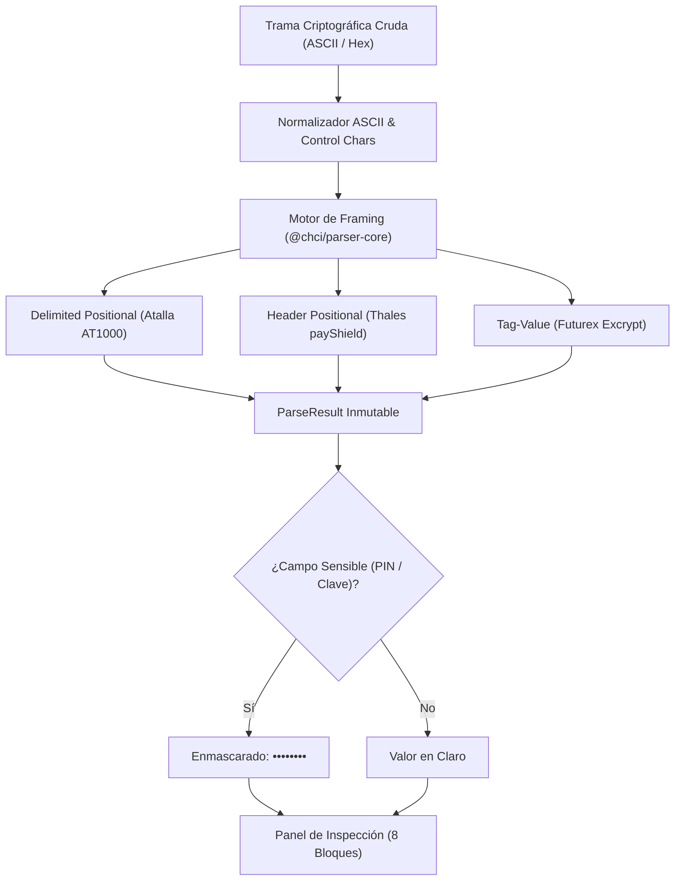
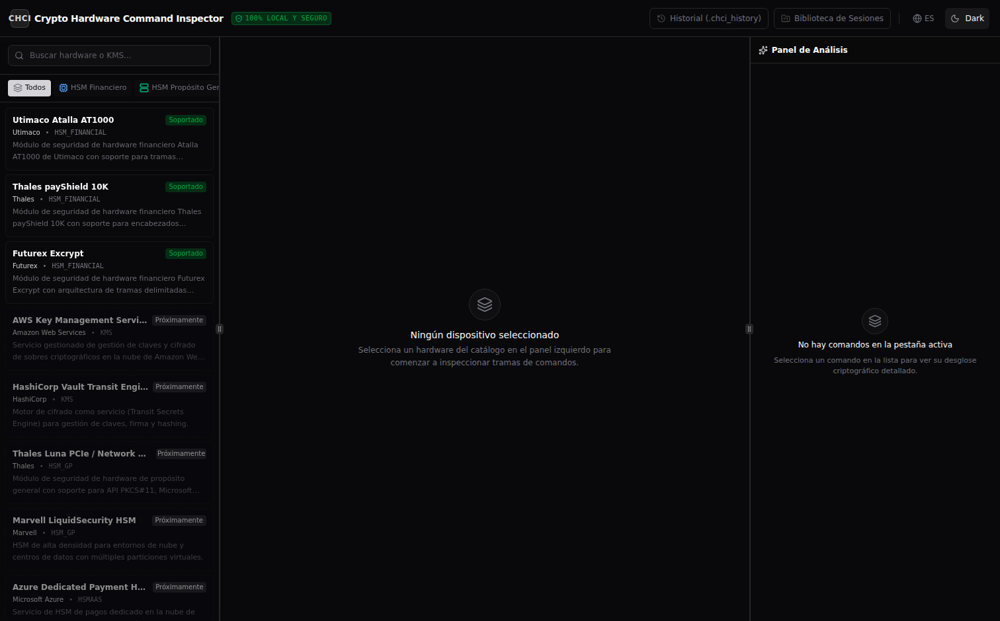
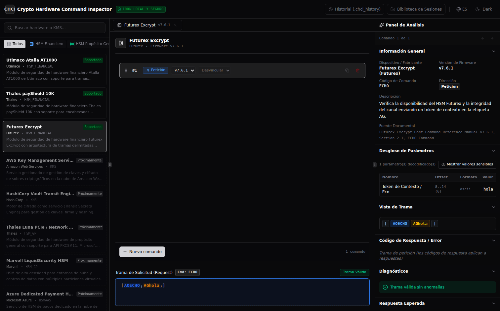
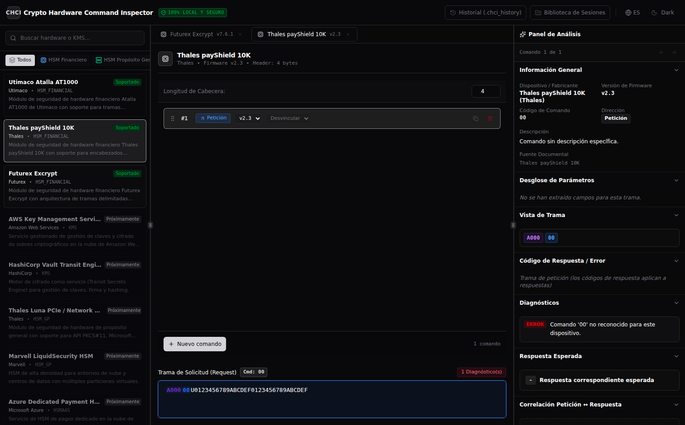
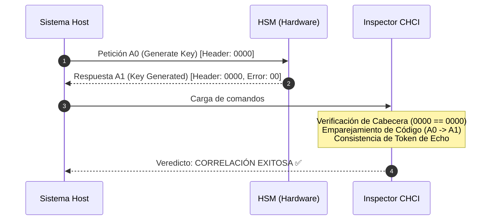
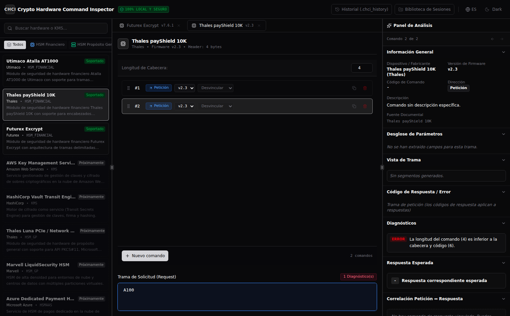
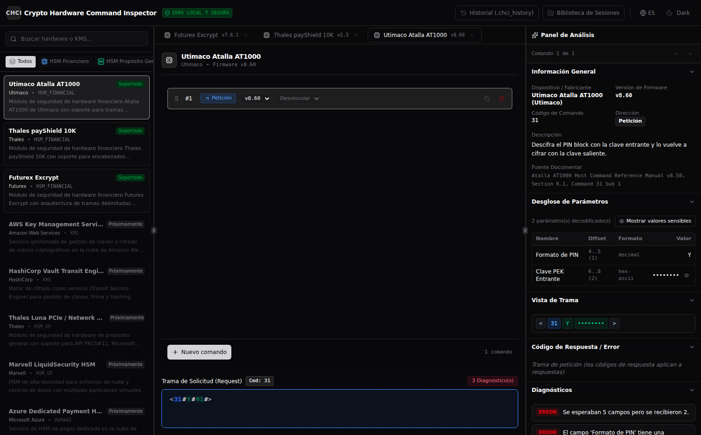
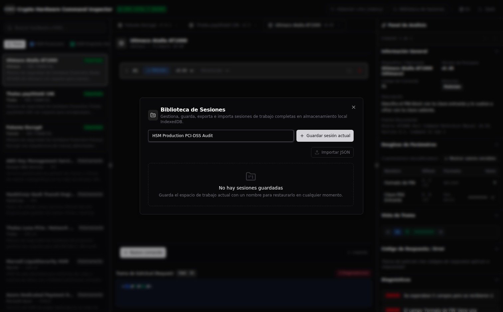
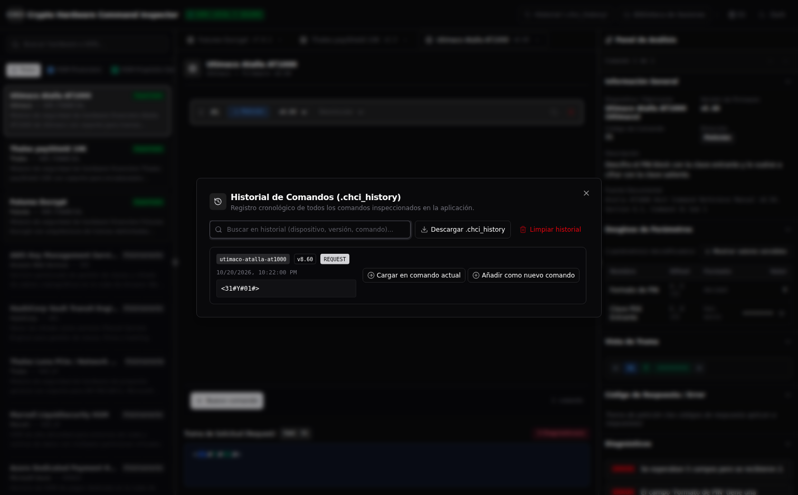
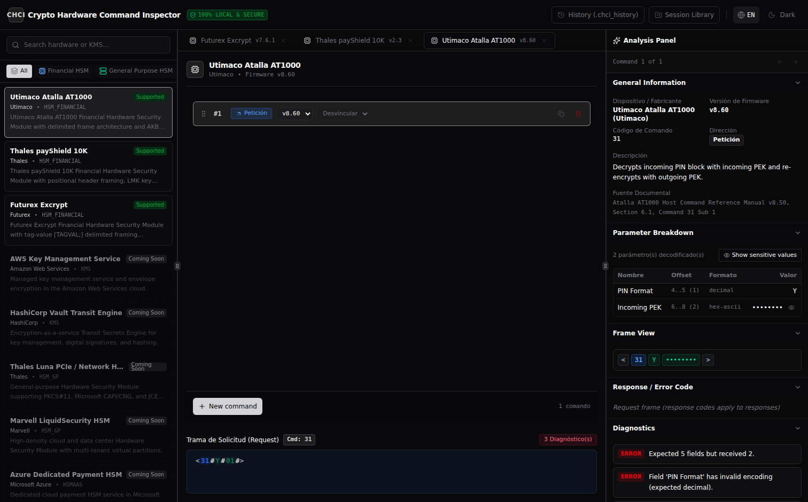

# Guía de Usuario — Crypto Hardware Command Inspector (`chci`)

Bienvenido a la **Guía de Usuario Oficial** de **Crypto Hardware Command Inspector (`chci`)**.

`chci` es una herramienta de inspección, depuración y auditoría criptográfica fuera de línea (*air-gapped*) diseñada para ingenieros de seguridad, desarrolladores de pasarelas de pago y operadores de infraestructura bancaria que interactúan diariamente con módulos de seguridad de hardware (**HSM**) y sistemas de gestión de claves (**KMS**).

---

## 1. Modelo de Seguridad y Filosofía Cero Red (Zero-Network)

Los comandos y tramas procesados por un HSM contienen con frecuencia material altamente sensible: bloques de PIN bancarios (ISO 9564), criptogramas de claves protegidas bajo LMK (Local Master Key), variantes de doble y triple longitud (3DES/AES) o bloques de clave ANSI X9.143 / TR-31.

Por este motivo, `chci` ha sido construido bajo una arquitectura estricta **Security-First**:

1. **Aislamiento 100% Fuera de Línea (*Air-Gapped*)**:
   - En la aplicación nativa de escritorio (**Tauri v2**), la política de seguridad (*Content Security Policy*) impone `connect-src 'none'`. No existe acceso a red, sockets TCP, WebSockets ni telemetría.
   - Todo el motor de parseo (`@chci/parser-core`), las especificaciones de hardware (`@chci/device-specs`) y la persistencia residen exclusivamente en memoria local y almacenamiento IndexedDB del dispositivo del usuario.
2. **Modo Web Sandbox**:
   - Si la aplicación se ejecuta en navegador web público de demostración (`VITE_TARGET=web`), se despliega de forma permanente un banner de advertencia alertando al operador para que no introduzca material criptográfico real en dicho entorno y recomendando la descarga del binario de escritorio.
3. **Enmascaramiento Sensible por Defecto**:
   - Todos los campos catalogados con `sensitive: true` (criptogramas de clave, bloques de PIN, componentes en claro) se enmascaran automáticamente con la máscara `••••••••`. El usuario puede revelarlos de forma puntual o global mediante un control explícito. Al cambiar de comando, todos los campos vuelven a enmascararse automáticamente.



---

## 2. Catálogo de Dispositivos y Navegación

El catálogo lateral permite explorar dispositivos clasificados en cuatro grandes familias:
- **HSM Financiero**: Utimaco / Atalla AT1000, Thales payShield 10K, Futurex Excrypt.
- **HSM Propósito General**: Utimaco CryptoServer, Thales Luna 7, Securosys Primus.
- **KMS**: HashiCorp Vault Transit, AWS KMS, Google Cloud KMS, Fortanix DSM.
- **HSM as a Service**: AWS CloudHSM, Azure Dedicated HSM, Marvell LiquidSecurity.

El usuario puede filtrar por categoría, realizar búsquedas de texto completo en tiempo real y abrir pestañas independientes para cada dispositivo soportado.

### Tema Claro


### Tema Oscuro


---

## 3. Flujo 1: Inspección de Comandos Futurex Excrypt

Los módulos **Futurex Excrypt** (como las series EXP9000 y Securus) emplean una estructura de encuadre basada en **Tag-Value**:
- La trama se delimita mediante corchetes angulares `[` y `]`.
- Cada parámetro se define mediante una etiqueta mnemotécnica de 2 caracteres (por ejemplo, `AO` para el código de comando, `AG` para el contexto o datos, `BB` para la cuenta, etc.), seguida del valor y concluida con un punto y coma `;`.

### Procedimiento:
1. Abra la pestaña **Futurex Excrypt** desde el catálogo lateral.
2. En el editor central, escriba o pegue la trama:
   ```text
   [AOECHO;AGhola;]
   ```
3. El editor CodeMirror resaltará visualmente los delimitadores `[` y `]`, los códigos de etiqueta y los valores.
4. En el **Panel de Análisis Detallado** (derecha), observe:
   - **Información General**: Código detectado `ECHO`, dirección `Petición`.
   - **Desglose de Parámetros**: Tabla interactiva con etiquetas `AO` y `AG`. Al pasar el cursor sobre cualquier fila, el editor resalta de forma sincronizada el rango exacto de la trama.



---

## 4. Flujo 2: Inspección y Enmascaramiento en Thales payShield 10K

Los módulos **Thales payShield 10K** (y 9000) utilizan un encuadre **Header-Positional**:
- Las tramas pueden comenzar con una cabecera de transporte de longitud configurable (generalmente 4 o 12 caracteres, e.g. `0000`).
- A continuación se encuentra el código de comando de 2 caracteres (`A0` para generación de claves, `NC` para diagnósticos, `CW` para importación).
- Los campos subsiguientes son estrictamente posicionales. Thales define campos de longitud dinámica mediante prefijos de clave (`U` para doble longitud 3DES, `T` para triple longitud, `S` para Thales Key Blocks, `R` para TR-31).

### Procedimiento de Inspección con Claves Sensibles:
1. Abra la pestaña **Thales payShield 10K**.
2. Configure la longitud de cabecera a `4` caracteres.
3. Introduzca la trama de generación de clave:
   ```text
   A00000U0123456789ABCDEF0123456789ABCDEF
   ```
4. Observe que el campo de clave bajo LMK se muestra automáticamente enmascarado como `••••••••`.
5. Para auditar el valor exacto, pulse el icono de revelado individual en la fila del parámetro o el conmutador global *"Mostrar sensibles"*.



---

## 5. Flujo 3: Correlación Petición ↔ Respuesta

En operaciones bancarias en vivo, es fundamental auditar si una respuesta recibida de un HSM corresponde fidedignamente a la petición cursada.



### Procedimiento:
1. En la pestaña activa, pulse **"Nuevo comando"** (`+`).
2. Defina el Comando #1 como `Petición` (`A0...`) y el Comando #2 como `Respuesta` (`A100`).
3. En el selector de vinculación del Comando #2, elija *"Vinculado al comando #1"*.
4. Despliegue el bloque **"Vínculo Petición ↔ Respuesta"** en el panel derecho para visualizar:
   - Comprobación de cabecera de transporte (*Header Match*).
   - Comprobación de código emparejado (*Command Pair Match*).
   - Comprobación de contexto/echo.



---

## 6. Flujo 4: Diagnóstico de Errores Utimaco Atalla AT1000

Los módulos **Utimaco / Atalla AT1000** utilizan tramas delimitadas por caracteres `#` dentro de `<` y `>`:
- Formato general: `<CMD#field1#field2#...#>`
- En caso de anomalía, el HSM retorna un código de error de 2 caracteres en la posición reservada.

### Procedimiento:
1. Abra la pestaña **Utimaco Atalla AT1000**.
2. Introduzca la trama de error:
   ```text
   <31#Y#01#>
   ```
3. El panel de análisis detecta inmediatamente la condición de error y despliega automáticamente los bloques:
   - **Código de Respuesta / Error**: Código `01`, nombre oficial *"Invalid command format"*, con lista detallada de causas técnicas documentadas por el fabricante (longitud incorrecta de campos, separador `#` ausente o carácter no hexadecimal).
   - **Diagnósticos**: Alertas graduadas por severidad (`error`, `warning`, `info`).



---

## 7. Flujo 5: Biblioteca de Sesiones y Exportación JSON

`chci` permite guardar el estado completo de la sesión de trabajo (múltiples pestañas, comandos, vínculos y configuraciones) en el almacenamiento IndexedDB local, así como exportar/importar archivos JSON validados:

- Formato de esquema: `chci-session-v1.json`.
- Validación estricta con **Zod** al importar, con protección contra inyecciones de esquemas ajenos y límite de seguridad de 10 MB.
- Funciones de la biblioteca: **Guardar sesión**, **Cargar sesión**, **Duplicar sesión**, **Eliminar sesión** y **Exportar/Importar JSON**.



---

## 8. Flujo 6: Historial de Auditoría estilo `.bash_history` (`.chci_history`)

Cada comando inspeccionado en la herramienta se registra automáticamente en una bitácora local de texto plano con formato idéntico a `.bash_history`:

```text
# Crypto Hardware Command Inspector History (.chci_history)
# Format: ISO_TIMESTAMP | DEVICE_ID | VERSION | DIRECTION | RAW_COMMAND
2026-10-20T20:10:00.000Z | futurex-excrypt | 7.6.1 | request | [AOECHO;AGhola;]
2026-10-20T20:11:00.000Z | thales-payshield-10k | 2.3 | request | A00000U0123456789ABCDEF0123456789ABCDEF
2026-10-20T20:11:30.000Z | thales-payshield-10k | 2.3 | response | A100
2026-10-20T20:12:00.000Z | utimaco-atalla-at1000 | 8.60 | response | <31#Y#01#>
```

Desde el modal de Historial (`Historial` en la cabecera):
- Filtre y busque tramas históricas en tiempo real.
- Inserte cualquier comando previo en el comando activo o como nuevo comando.
- Descargue el archivo `.chci_history` a su máquina local o limpie el historial.



---

## 9. Internacionalización Bilingüe (Español / Inglés)

Toda la aplicación, incluyendo catálogos, descripciones de parámetros criptográficos, manuales de códigos de error y avisos de diagnóstico, cuenta con soporte nativo bilingüe (Español e Inglés):
- Pulse el botón de selector de idioma (`ES` / `EN`) en la cabecera superior para alternar instantáneamente la interfaz sin recargar la página ni perder el estado de trabajo.



---

## 10. Resumen de Atajos y Consejos Prácticos

| Acción | Atajo / Procedimiento |
|---|---|
| **Alternar Tema** | Botón de tema en cabecera (`dark` / `light` / `system`). |
| **Alternar Idioma** | Botón `ES` / `EN` en cabecera. |
| **Reordenar Comandos** | Arrastrar el icono de agarre (`:::`) en la lista de comandos. |
| **Revelar Clave/PIN** | Clic en el icono de ojo en la fila de parámetro del panel de análisis. |
| **Cerrar Modales** | Tecla `Escape` o clic fuera del diálogo. |
| **Descargar Sesión** | Sesiones -> Botón *Exportar JSON*. |
| **Descargar Bitácora** | Historial -> Botón *Descargar .chci_history*. |
