# Guía de Usuario Oficial — Crypto Hardware Command Inspector (`chci`)

Bienvenido a la **Guía de Usuario Oficial y Completa** de **Crypto Hardware Command Inspector (`chci`)** para la versión **v1.0.0**.

`chci` es una estación de trabajo criptográfica de escritorio fuera de línea (*air-gapped*) diseñada para ingenieros de ciberseguridad, desarrolladores de pasarelas de pago, auditores PCI-DSS y operadores de banca que interactúan diariamente con Módulos de Seguridad de Hardware (**HSM**) y Sistemas de Gestión de Claves (**KMS**).

---

## 1. Modelo de Seguridad y Filosofía Cero-Red (Zero-Network)

El software bancario y de seguridad opera con material criptográfico altamente sensible:
- Bloques de PIN (ISO 9564 Formatos 0, 1, 3, 4).
- Criptogramas de claves protegidos bajo Claves Maestras Locales (LMK / MFK).
- Variantes de doble y triple longitud 3DES/AES y bloques ANSI X9.143 / TR-31.
- Claves privadas asimétricas (RSA, ECC Curve25519, NIST P-256).

Por ello, `chci` implementa una política estricta **Security-First**:

1. **Aislamiento Fuera de Línea (*Air-Gapped*)**:
   - En la aplicación nativa (**Tauri v2**), la directiva CSP (*Content Security Policy*) impone `connect-src 'none'`. No existe acceso a Internet, servidores remotos ni telemetría.
   - El motor de parseo (`@chci/parser-core`), las especificaciones técnicas (`@chci/device-specs`), el almacenamiento y la documentación residen 100% en la máquina local.
2. **Enmascaramiento Sensible por Defecto**:
   - Todo campo marcado como `sensitive: true` (criptogramas de clave, bloques de PIN, componentes claros) se enmascara automáticamente como `••••••••`.
   - El operador puede revelar u ocultar valores sensibles de forma puntual o global mediante el conmutador de la interfaz. Al cambiar de comando, todos los campos vuelven a protegerse inmediatamente.
3. **Persistencia Segura y Local**:
   - Las sesiones de trabajo se guardan en el IndexedDB del navegador o en archivos locales validados con **Zod** (`chci-session-v1.json` y bitácora plana `.chci_history`).

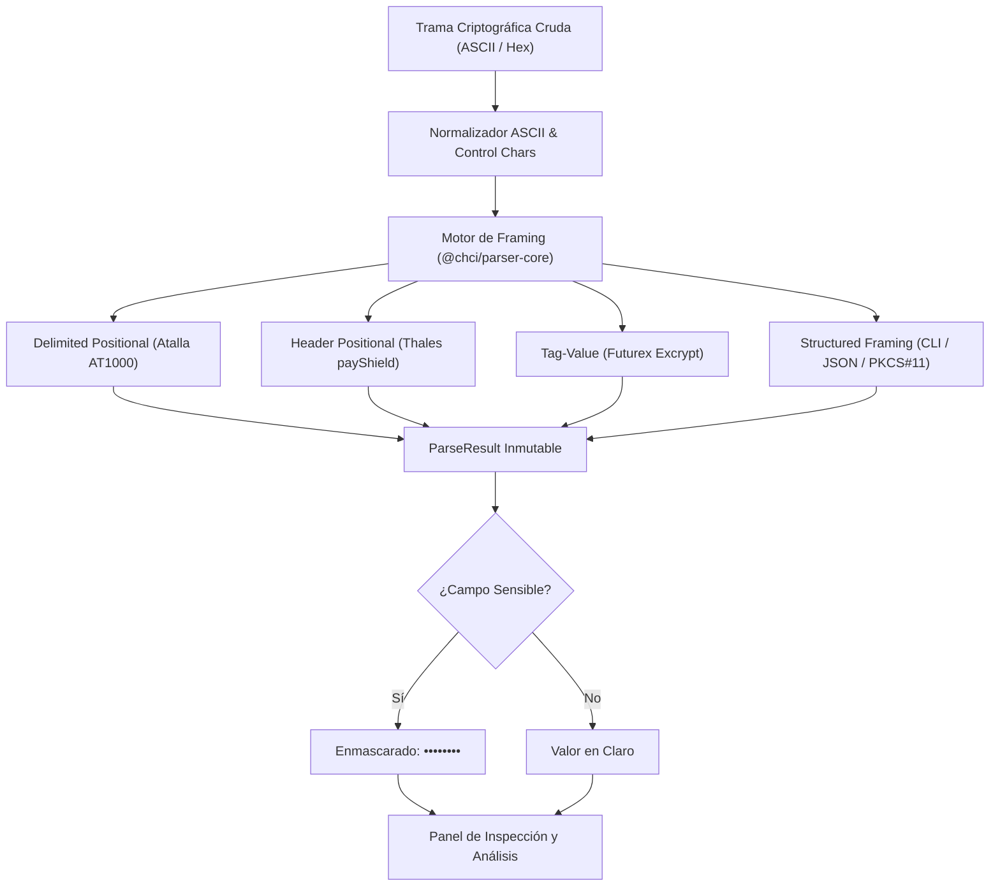

---

## 2. Instalación y Despliegue Multiplataforma

`chci` se distribuye oficialmente como instaladores nativos para los tres sistemas operativos:

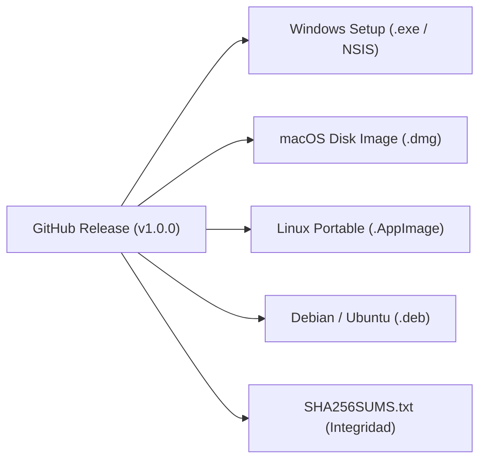

### 2.1 En Windows (Instalador Modular NSIS)
El instalador `Crypto-Hardware-Command-Inspector_x64-setup.exe` ofrece un asistente interactivo:
- **Selector de Carpeta de Destino (`Custom Destination Folder`)**: El usuario puede pulsar *"Examinar..."* y elegir cualquier ruta o unidad (ej: `D:\Herramientas\CHCI`).
- **Selector de Componentes Modular**:
  - ☑️ **CHCI Core Application**: Programa principal y visor de especificaciones (~45 MB, Obligatorio).
  - 🔲/☑️ **Simulador Utimaco Atalla AT1000 v8.56**: Imagen Docker offline `.tar` (~848 MB, Opcional). Desplegado en `$INSTDIR\simulators\atalla-at1000\`.
  - 🔲/☑️ **Simulador Thales payShield 10K v2.3**: Ejecutable nativo Rust `thales-simulator.exe` y plantilla LMK (~5 MB, Opcional). Desplegado en `$INSTDIR\simulators\thales-payshield\`.
  - 🔲/☑️ **Simulador Futurex Excrypt Plus v7.6.1**: Ejecutable nativo Rust `futurex-simulator.exe` y plantilla MFK (~5 MB, Opcional). Desplegado en `$INSTDIR\simulators\futurex-excrypt\`.
  - 🔲/☑️ **Simulador Marvell LiquidSecurity v3.4.0**: Ejecutable nativo Rust `liquidsecurity-simulator.exe` y plantilla de configuración (~5 MB, Opcional). Desplegado en `$INSTDIR\simulators\marvell-liquidsecurity\`.
- **Accesos Directos Opcionales (NO automáticos)**:
  - Casilla: *Crear acceso directo en el Escritorio* (desmarcada por defecto).
  - Casilla: *Crear acceso directo en el Menú Inicio* (desmarcada por defecto).
  - Solo se crean aquellos que el operador marque expresamente.

### 2.2 En macOS (Imagen de Disco `.dmg`)
- Al abrir el archivo `Crypto-Hardware-Command-Inspector_universal.dmg`, el usuario arrastra la aplicación `Crypto Hardware Command Inspector.app` a `/Applications` o a la carpeta que desee.
- No se crean accesos directos al Escritorio. El usuario puede anclar la aplicación al Dock según su preferencia.

### 2.3 En Linux (AppImage y DEB)
- **AppImage Universal**: Binario portable ejecutable sin instalación en cualquier distribución Linux (Ubuntu, Debian, Fedora, Arch, SUSE). El usuario lo almacena en la carpeta de su elección (ej: `~/bin/` o `/opt/`).
- **Paquete Debian (`.deb`)**: Instalación nativa mediante `sudo dpkg -i chci.deb` con integración limpia en el menú del sistema.

---

## 3. Catálogo de Dispositivos Criptográficos Soportados

La barra lateral izquierda categoriza los 10 dispositivos soportados en 4 familias arquitectónicas:

1. **HSM Financiero / Payment HSM**:
   - **Utimaco Atalla AT1000** (Firmware v8.60 / v8.56).
   - **Thales payShield 10K** (Firmware v2.3 / v1.9).
   - **Futurex Excrypt** (Firmware v7.6.1).
2. **HSM de Propósito General**:
   - **Thales Luna 7** (PKCS#11 y CLI Lunash).
   - **IBM CCA 4769** (Callable C Verbs y CLI).
   - **Yubico YubiHSM 2** (YubiHSM-Shell CLI y PKCS#11).
3. **KMS (Key Management Systems)**:
   - **AWS KMS** (REST JSON y AWS CLI).
   - **HashiCorp Vault Transit** (REST API v1 y CLI).
4. **HSM as a Service / Cloud HSM**:
   - **Marvell LiquidSecurity HSM** (Liquid CLI v3.4.0 y PKCS#11).
   - **Azure Dedicated Payment HSM** (TCP RAW y CLI).

### Vista General en Tema Claro

### Vista General en Tema Oscuro

---

## 4. Editor de Comandos y Selector de Interfaces

El panel central de la aplicación proporciona un entorno de edición enriquecido basado en **CodeMirror 6**:

- **Resaltado de Sintaxis en Tiempo Real**: Delimitadores, etiquetas, campos posicionales y datos hexadecimales se identifican visualmente con colores específicos.
- **Selector de Interfaz Estándar vs Propietaria**:
  - Para dispositivos que admiten múltiples interfaces (como Thales Luna 7 o Marvell LiquidSecurity), cada comando dispone de un selector desplegable con indicador visual:
    - `[STD]` Interfaz Estándar de la Industria (ej: PKCS#11, REST JSON, KMIP).
    - `[PROP]` Interfaz Propietaria del Fabricante (ej: CLI nativa, RAW ASCII).

---

## 5. Panel de Análisis Criptográfico y Vista de Trama

El panel lateral derecho desglosa en tiempo real cada elemento de la trama introducida:

1. **Vista de Trama Segmentada**: Representación visual tipo bloque donde cada parámetro se muestra con su nombre oficial y color de categoría.
2. **Desglose de Parámetros Multilínea**: Tabla estructurada con ajuste forzado `break-all` y `table-fixed` que previene cualquier desbordamiento o scroll horizontal en claves de 74 o 128 caracteres.
3. **Soporte Dual-Mode AKB vs Variant**:
   - Detección automática del modo de clave:
     - 🌸 **AKB (Atalla Key Block)**: Clave formateada en bloque de 74 caracteres. Badge distintivo en rosa.
     - 🟪 **Variant**: Clave encriptada bajo variante tradicional (32 o 48 caracteres). Badge distintivo en morado.
4. **Descripciones Técnicas Expandibles `(i)`**: Al pulsar el botón de información en cualquier fila, se expande la explicación detallada del manual oficial con formatos válidos y ejemplos de uso.
5. **Avisos Oficiales del Fabricante**: Tarjetas estilizadas destacando `CAUTION`, `IMPORTANT`, `TIP` y `NOTE`.

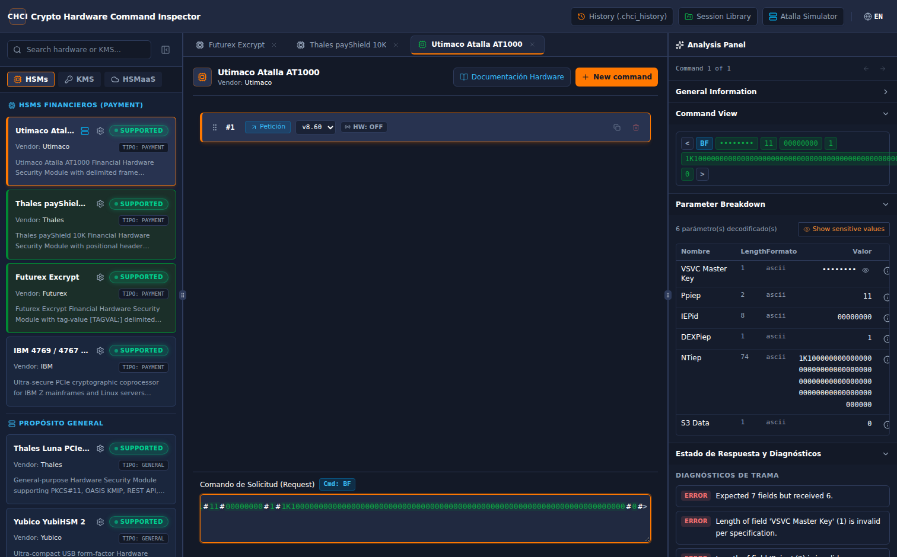

---

## 6. Inspección de Comandos Utimaco Atalla AT1000

El encuadre **Delimited Positional** de Atalla utiliza los delimitadores `<` y `>` con separadores `#`:
- Formato general: `<CmdCode#SubCode#Param1#Param2#...#>`

### Ejemplo: Comando Atalla `31` con Error
Al inspeccionar una respuesta de error `<31#Y#01#>`:
- El inspector identifica el código de error `01` (*"Invalid command format"*).
- Muestra el desglose de causas documentadas (longitud errónea, campo numérico inválido, delimitador `#` faltante).

---

## 7. Inspección de Comandos Thales payShield 10K

El encuadre **Header-Positional** de Thales payShield utiliza una cabecera de transporte configurable seguida del código de comando de 2 caracteres:
- Formato general: `[Header 4B][Code 2B][Data...]`
- Identificación de tipo de clave por prefijos oficiales:
  - `U`: Clave 3DES doble longitud (32 hex).
  - `T`: Clave 3DES triple longitud (48 hex).
  - `S`: Thales Key Block propietario.
  - `R`: ANSI X9.143 / TR-31 Key Block.

### Enmascaramiento de Claves bajo LMK
Al introducir una trama como `A00000U0123456789ABCDEF0123456789ABCDEF`:
- El campo de clave bajo LMK se oculta por defecto mediante `••••••••`.
- El icono de ojo permite revelar u ocultar la clave bajo demanda controlada del operador.

---

## 8. Inspección de Comandos Futurex Excrypt

Los HSMs **Futurex Excrypt** emplean encuadre **Tag-Value**:
- La trama inicia con `[` y finaliza con `]`.
- Cada parámetro consta de una etiqueta de 2 caracteres (`AO`, `AG`, `BB`, etc.) seguida del valor y finalizada con punto y coma `;`.

### Ejemplo: Comando Echo
Al introducir `[AOECHO;AGhola;]`:
- Se desglosa `AO` como código de comando `ECHO`.
- Se desglosa `AG` como datos de usuario (*Context Data*).

---

## 9. Correlación Automática de Petición ↔ Respuesta

En auditorías bancarias es indispensable verificar si la respuesta devuelta por el HSM concuerda con la petición original.

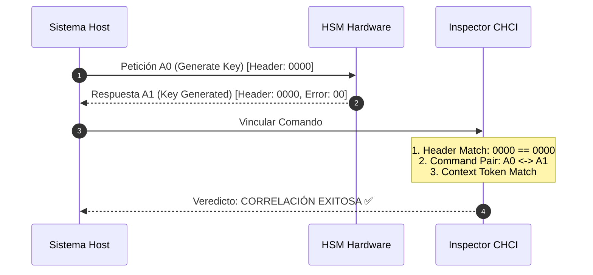

### Procedimiento:
1. Cree un comando #1 como `Petición` (`A0...`).
2. Cree un comando #2 como `Respuesta` (`A100...`).
3. En el comando #2, seleccione *"Vinculado al comando #1"*.
4. El bloque **"Vínculo Petición ↔ Respuesta"** verificará automáticamente la paridad de cabecera, código y contexto.

---

## 10. Visor Integrado de Documentación Hardware Offline

`chci` integra los manuales técnicos oficiales de los fabricantes accesibles sin conexión a red:
- **Botón en Cabecera**: Acceso directo al visor de documentación técnica.
- **Pestañas de Filtrado**: Permite filtrar por *"Todos"*, *"Capítulos"*, *"Comandos"* o *"Apéndices"*.
- **Búsqueda Instantánea**: Filtrado en tiempo real por código de comando (ej: `BF`, `A0`, `ECHO`) o descripción.
- **Markdown Enriquecido**: Resaltado sintáctico, filas AKB/Variant coloreadas, enlaces interactivos y avisos oficiales del fabricante.

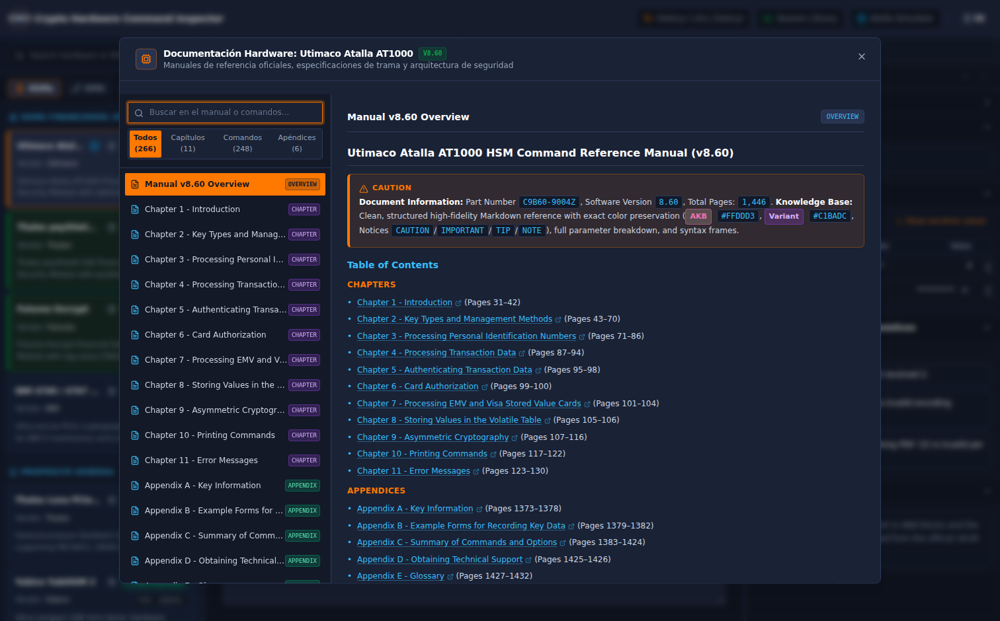

---

## 11. Simuladores de Hardware HSM Integrados

Para desarrollo y pruebas locales sin disponer de hardware físico en rack, `chci` integra una suite completa de simuladores para los cuatro principales entornos HSM del mercado:

### 11.1 Simulador Oficial Utimaco Atalla AT1000 (Docker)
- **Gestión por Contenedor**: Requiere Docker Desktop/daemon y utiliza la imagen `utimaco_atalla_simulator_8.56`.
- **Telemetría en Vivo**: Estado del firmware SMOS SDK 5.6.4.1, número de serie `SIM123`, y Master File Keys (`MFK1: B196`, `AMK1: B9BC`).
- **Barra de Progreso Animada**: Monitoriza los 4 hitos de arranque (~30s): Contenedor Docker, Kernel SMOS, Memoria Flash y Socket TCP :7000.
- **Monitor de Salud (Heartbeat)**: Sondeo continuo cada 4.5s que detecta caídas inesperadas del contenedor.
- **Auto-conexión**: Conexión directa a `127.0.0.1:7000` con sintaxis delimitada `<CMD#...#>`.

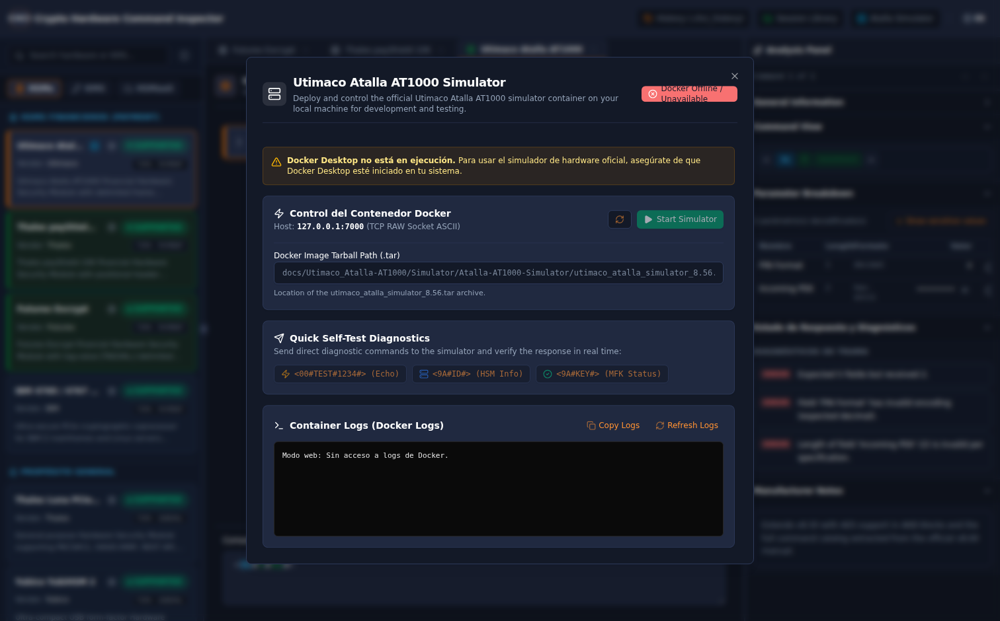

### 11.2 Simulador Nativo Thales payShield 10K (Rust)
- **Ultra-rápido y Nativo**: Desarrollado en Rust puro (`crates/payment-simulators`), arranca en menos de 5 milisegundos sin requerir Docker ni máquinas virtuales.
- **Encuadre Exacto Thales**: Soporta el protocolo TCP estándar con prefijo de longitud Big-Endian de 2 bytes (`[Length 2B][Header mB][Command 2B][Data...]`).
- **Esquema de Claves LMK**: Incluye por defecto LMK Pair 00 (2TDES con KCV `08D7B4`) con soporte para derivación de variantes (ZMK, ZPK, PVK, CVK) y Thales Key Blocks (TR-31).
- **Comandos Soportados**:
  - `NC` / `ND`: Diagnóstico de red, estado del firmware `PS10-2.3a` y check digits de LMK.
  - `A0` / `A1`: Generación de claves bajo LMK con KCV de control.
  - `CW` / `CX`: Generación y verificación de CVV/CVC según algoritmo estándar Visa.
  - `EE` / `EF`: Generación y cálculo de offsets IBM 3624.
  - `FA` / `FB`: Verificación de PIN Block ISO-0 (ANSI X9.8).
  - `M0` / `M1` y `M2` / `M3`: Generación y verificación de MAC Retail (ISO 9797-1 Algoritmo 3).
- **Auto-conexión**: Conexión a `127.0.0.1:1500` con encuadre `header-positional`.

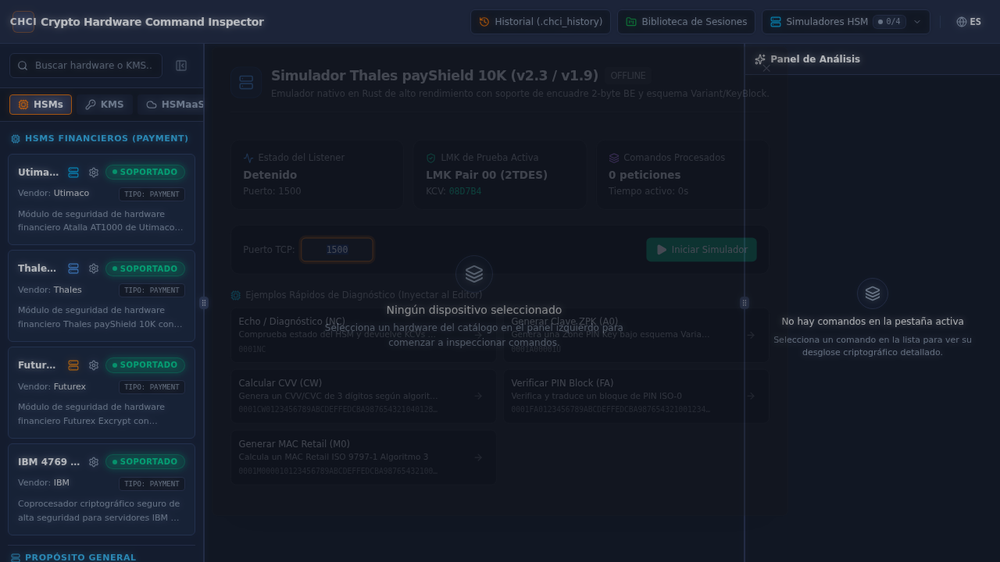

### 11.3 Simulador Nativo Futurex Excrypt Plus (Rust)
- **Ultra-rápido y Nativo**: Motor en Rust puro sin dependencias externas en puerto TCP `9000`.
- **Sintaxis Tag-Valor Bracketed**: Formato de tramas entre corchetes `[AO<cmd>;TOKENval;]`.
- **Esquema de Claves MFK**: Configurado por defecto con Major File Key (MFK de 2TDES con KCV `08D7B4`) para derivación y protección de claves de trabajo.
- **Reflexión de Token AG**: Todo token `AG<texto>;` enviado en la petición se devuelve íntegro en la respuesta.
- **General Failure Tag**: Respuestas exitosas marcadas con `GFY;` y respuestas de error con `[AOERRO;AM<cód>;AN<tag>;BB<desc>;GFN;]`.
- **Comandos Soportados**:
  - `ECHO`: Verificación de conectividad.
  - `VR`: Versión del sistema y firmware `Excrypt Plus HSM Simulator`.
  - `KG`: Generación de claves bajo MFK con KCV de control.
  - `BB`: Traducción de bloques PIN entre claves de zona.
  - `BO`: Verificación de PIN / CVV.
  - `DN`: Cifrado y descifrado simétrico de datos.
  - `FM`: Cálculo y formateo de MAC financiero.
- **Auto-conexión**: Conexión a `127.0.0.1:9000` con encuadre `tag-value`.

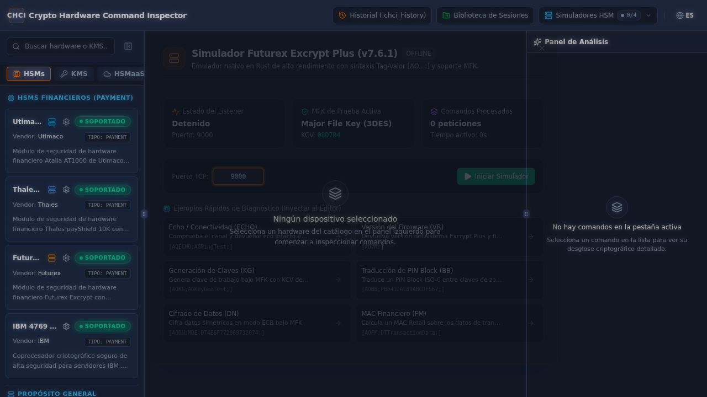

### 11.4 Simulador Nativo Marvell LiquidSecurity HSM (Rust)
- **Ultra-rápido y Nativo**: Motor en Rust puro en puerto TCP `2225` emulando el procesador criptográfico Marvell NITROX PCIe (firmware 3.4.0).
- **Multi-Tenant y Particionado Virtual**: Soporta asignación de particiones independientes (`PART_CREATE`) con cuotas dedicadas de claves y memoria aislada.
- **Doble Interfaz de Comunicación**:
  - **Consola de Gestión CLI**: Comandos estructurados de diagnóstico de hardware (`KRN_STATUS` con telemetría de temperatura a 42°C, `PART_CREATE`, `CLUSTER_SYNC`).
  - **Llamadas OASIS PKCS#11 v2.40**: Verbos estándar de la API C Cryptoki (`C_Initialize`, `C_GenerateKey` con cálculo de AES KCV, `C_Encrypt`).
- **Auto-conexión**: Conexión a `127.0.0.1:2225` con soporte para encuadre estructurado CLI y callable.

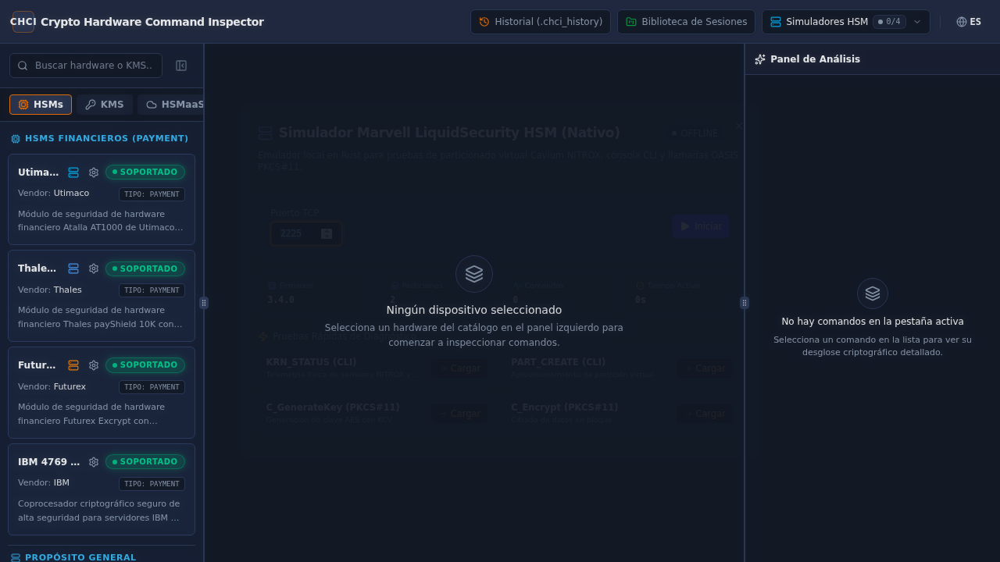

### 11.5 Centro de Control Unificado de Simuladores (Hub Desplegable)
`chci` agrupa todos los simuladores en un único menú desplegable interactivo accesible desde la barra superior (`Header`):
- **Badge de Estado en Vivo**: Muestra en todo momento el número de simuladores activos frente al total (ej: `🟢 2/4`).
- **Puertos Dedicados Sin Conflictos**: Cada simulador se ejecuta en su propio puerto TCP sin colisiones:
  - Atalla AT1000: `TCP :7000`
  - Thales payShield 10K: `TCP :1500`
  - Futurex Excrypt Plus: `TCP :9000`
  - Marvell LiquidSecurity: `TCP :2225`
- **Control Masivo ("Activar Todos")**: Un solo clic en el botón *"Activar Todos"* levanta concurrentemente todos los simuladores instalados. El botón conmuta a *"Detener Todos"* cuando hay simuladores en ejecución.
- **Acceso Contextual**: Cada fila permite arrancar/detener el simulador individualmente o acceder a su consola de diagnóstico.

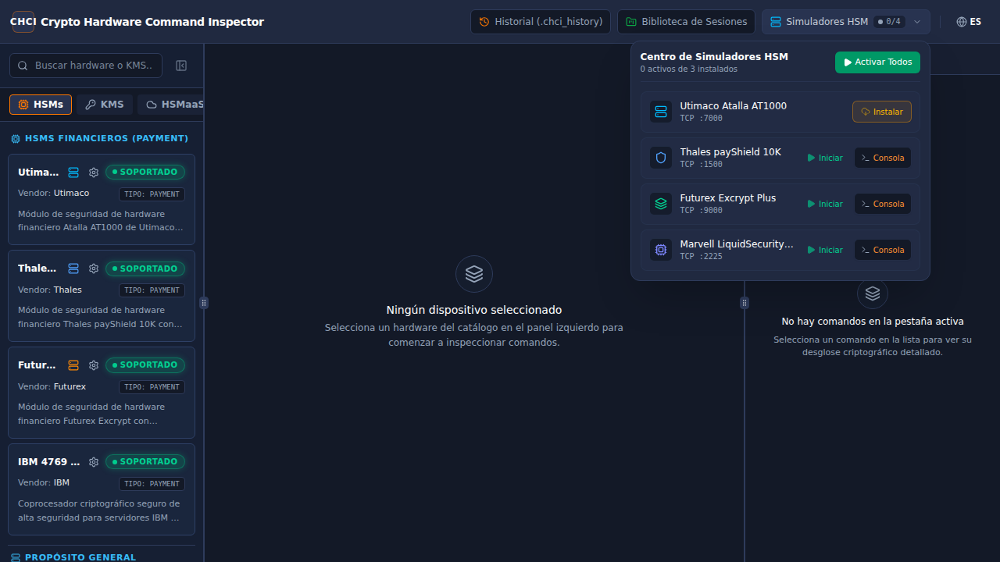

### 11.6 Descarga e Instalación en Tiempo de Ejecución
Para simuladores que no se hayan seleccionado en el instalador NSIS o al utilizar versiones portables:
- **Detección Dinámica de Instalación**: La aplicación detecta en tiempo real si los binarios, configuraciones o imágenes Docker existen en el sistema.
- **Botón "Instalar" Contextual**: Los simuladores ausentes muestran un botón destacado *"Instalar"*.
- **Asistente de Instalación Dual**:
  1. **Descarga Online**: Descarga asistida con barra de progreso animada y verificación de integridad checksum.
  2. **Carga de Archivo Local**: Diseñado para servidores **Air-Gapped** bancarios sin internet; permite seleccionar cualquier archivo local `.zip`, `.tar` o `.tar.gz` para su extracción y registro inmediato en el espacio de usuario (`%APPDATA%\chci\simulators\`).

### 11.7 Parada Automática Unificada
Al cerrar la aplicación (`X`, `Alt+F4`, menú salir o terminación del proceso), `chci` apaga ordenadamente:
- El contenedor Docker de Atalla (`docker stop` y `docker rm`).
- El socket TCP del simulador Thales (puerto 1500).
- El socket TCP del simulador Futurex (puerto 9000).
- El socket TCP del simulador LiquidSecurity (puerto 2225).
Sin dejar procesos huérfanos ni puertos bloqueados en el sistema operativo.

---

## 12. Conexiones Directas a Hardware y Ejecución en Vivo

Para validar comandos contra dispositivos reales o proxies bancarios:
- **Configuración de Protocolos**: Admite conexiones TCP directas, TLS cifrado o mTLS con autenticación mutua de certificados.
- **Credenciales y Certificados PEM**: Campos para configurar el certificado CA del servidor, el certificado de cliente y la clave privada de cliente en formato PEM.
- **Ejecución en Vivo con Diagnóstico de Red**: Botón *Play* en el editor para enviar la trama y recibir la respuesta en vivo con medición de latencia en milisegundos.

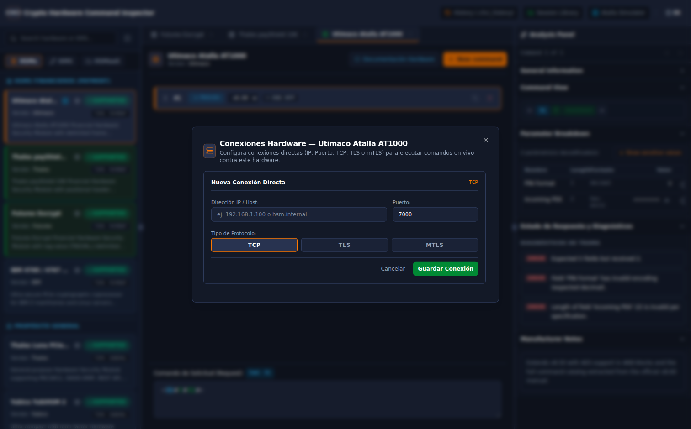

---

## 13. Biblioteca de Sesiones, Historial y Exportación JSON

- **Biblioteca de Sesiones IndexedDB**: Guarde, cargue, clone y gestione múltiples sesiones de auditoría con todas sus pestañas, comandos y configuraciones intactas.
- **Importación/Exportación JSON con Zod**: Exportación en formato abierto `chci-session-v1.json` con validación rigurosa de esquema para compartir sesiones entre auditores.
- **Bitácora Plana `.chci_history`**: Registro automático en texto plano estilo `.bash_history` con marca temporal ISO, identificador de dispositivo, versión, dirección y trama cruda. Permite búsqueda rápida, reinserción de comandos y descarga directa del archivo.

### Biblioteca de Sesiones

### Historial de Auditoría (.chci_history)

---

## 14. Soporte Multilingüe (Español / English / Galego)

Toda la aplicación, catálogos, campos y diagnósticos de error cuentan con soporte idiomático completo:
- Selector en cabecera para conmutar al instante entre **Español (`ES`)**, **English (`EN`)** y **Galego (`GL`)** sin recargar la página ni perder el estado de la sesión activa.

---

## Resumen de Atajos y Procedimientos Rápidos

| Operación | Método / Atajo |
|---|---|
| **Nuevo Comando** | Botón `+` en cabecera o lista de comandos. |
| **Documentación Hardware** | Botón con icono de libro en cabecera. |
| **Simulador Atalla** | Botón con icono de servidor en cabecera o sidebar. |
| **Conexiones Directas** | Botón con icono de enlace en la tarjeta del dispositivo. |
| **Revelar Clave/PIN** | Clic en el icono de ojo en la fila de parámetro del panel de análisis. |
| **Ver Detalles de Parámetro** | Botón `(i)` en la fila del parámetro de la tabla. |
| **Exportar Sesión** | Sesiones -> Botón *Exportar JSON*. |
| **Descargar Bitácora** | Historial -> Botón *Descargar .chci_history*. |
| **Cerrar Diálogos** | Tecla `Escape` o clic fuera del modal. |
